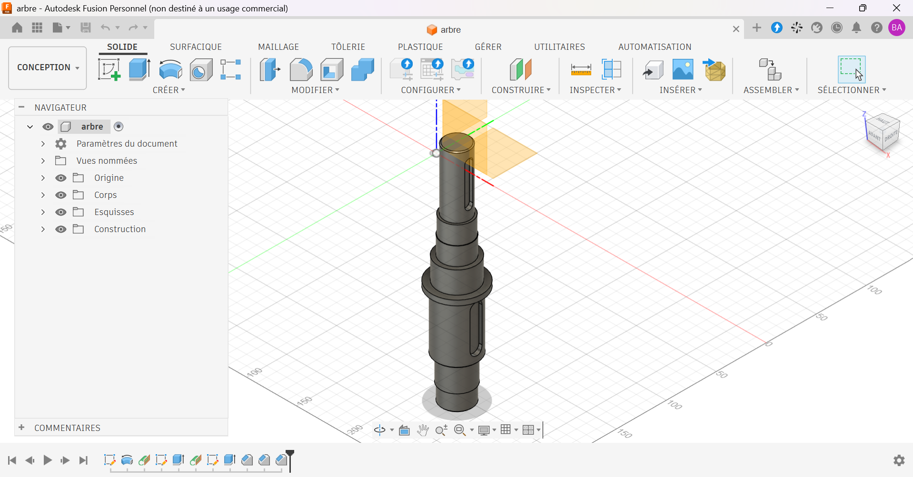

# Arbre étagé à rainures de clavette

Arbre de transmission étagé modélisé sous Autodesk Fusion.

## Contexte

Exercice d'apprentissage réalisé en autodidacte pour me former à la conception d'arbres mécaniques : étagement des diamètres, épaulement, chanfrein et rainures de clavette.

## Caractéristiques

| Élément | Valeur |
|---|---|
| Longueur totale | [À COMPLÉTER] mm |
| Diamètres | Ø[À COMPLÉTER] / Ø[À COMPLÉTER] / Ø[À COMPLÉTER] mm |
| Épaulement | Ø[À COMPLÉTER] mm |
| Rainures de clavette | 2 × [À COMPLÉTER] mm (largeur × longueur) |
| Matériau prévu | [À COMPLÉTER] |

## Fichiers

| Fichier | Contenu |
|---|---|
| `arbre.step` | Format universel, ouvrable dans tout logiciel de CAO |
| `arbre.stl` | Maillage, visualisable directement en 3D sur GitHub |
| `images/` | Rendus et captures |

## Outils

- Autodesk Fusion (licence personnelle, usage non commercial)

## Pistes d'amélioration

- Réaliser la mise en plan avec cotation fonctionnelle et tolérances sur les portées.
- Concevoir les clavettes et la pièce montée sur l'arbre (par exemple le pignon).
- Ajouter les congés de raccordement aux changements de diamètre.

## Auteur

Yan AKOUEDENOUDJE — [Portfolio](https://yanakouedenoudje.github.io) · [GitHub](https://github.com/yanakouedenoudje)
