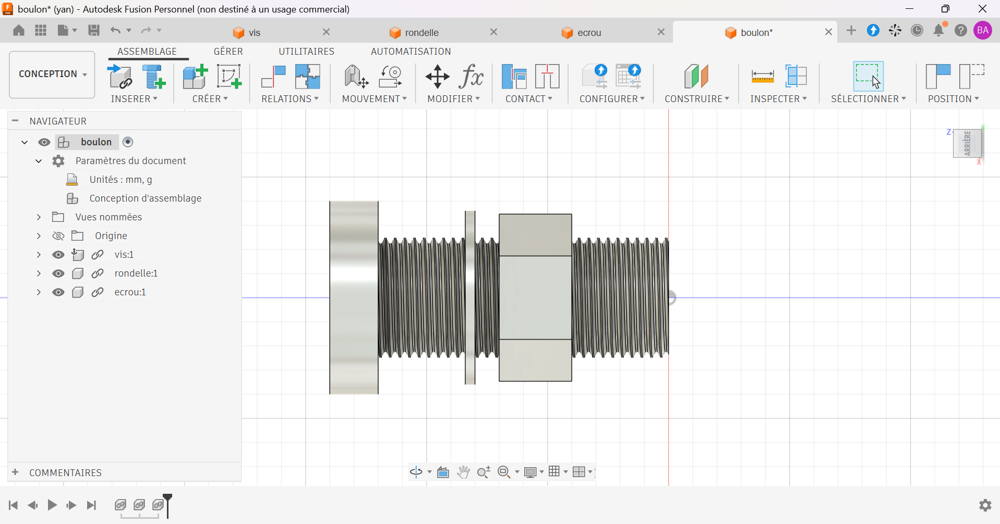

# Assemblage boulonné : vis, rondelle et écrou

Assemblage d'une vis à tête cylindrique, d'une rondelle et d'un écrou hexagonal, modélisé sous Autodesk Fusion.

## Contexte

Exercice d'apprentissage réalisé en autodidacte pour me former à la modélisation de pièces normalisées et à l'assemblage sous Autodesk Fusion.

## Caractéristiques

| Élément | Valeur |
|---|---|
| Vis | Tête cylindrique, filetage hélicoïdal, M25X2 |
| Rondelle | Placée sous la tête de la vis, Ø28 mm |
| Écrou | Hexagonal, M25x2 |
| Matériau | Alluminium - Microbillé |

## Fichiers

| Fichier | Contenu |
|---|---|
| `assemblage.f3d` | Fichier source Autodesk Fusion |
| `assemblage.step` | Format universel |
| `assemblage.stl` | Maillage pour l'impression 3D |
| `images/` | Rendus et captures |

## Outils

- Autodesk Fusion (licence personnelle, usage non commercial)

## Pistes d'amélioration

- Ajouter la ou les plaques à serrer pour illustrer le rôle réel de l'assemblage.
- Créer une vue éclatée et une mise en plan d'ensemble avec nomenclature.
- Indiquer la norme des pièces (écrou, rondelle, vis).

## Auteur

Yan AKOUEDENOUDJE — [Portfolio](https://yanakouedenoudje.github.io) · [GitHub](https://github.com/yanakouedenoudje)
