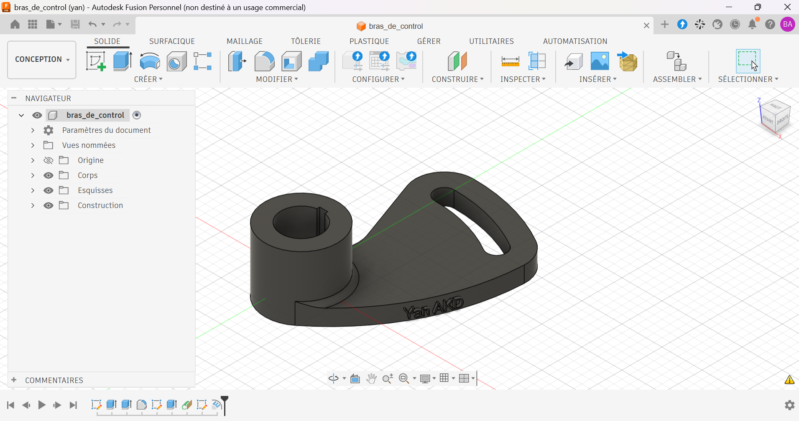

# Bras de commande à lumière courbe

Bras de commande modélisé sous Autodesk Fusion.

## Contexte

Exercice d'apprentissage réalisé d'après un plan de référence : [À COMPLÉTER : nom du tutoriel ou de l'auteur, avec le lien]. Le modèle 3D est de ma réalisation ; le plan de départ ne m'appartient pas et n'est pas reproduit dans ce dépôt.

## Caractéristiques

| Élément | Valeur |
|---|---|
| Épaisseur de la plaque | 10 mm |
| Moyeu | Ø45 mm, longueur 40 mm |
| Alésage | Ø25 mm |
| Rainure de clavette | 5 × 3 mm |
| Lumière en arc | rayon 89,25 mm sur 30° |
| Matériau prévu | Acier |

## Ma contribution

- Modélisation 3D complète à partir du plan de référence.
- Réalisation de ma propre mise en plan : vues, coupe A-A, vue de détail B, gravure personnalisée.
- [À COMPLÉTER : autres modifications.]

## Fichiers

| Fichier | Contenu |
|---|---|
| `bras_commande.step` | Format universel |
| `bras_commande.stl` | Maillage, visualisable en 3D sur GitHub |
| `bras_commande_plan.pdf` | Ma mise en plan (Fusion) |
| `images/` | Rendus et captures |

## Outils

- Autodesk Fusion (licence personnelle, usage non commercial)

## Pistes d'amélioration

- Compléter la cotation et les tolérances de la mise en plan.

## Auteur

Yan AKOUEDENOUDJE — [Portfolio](https://yanakouedenoudje.github.io) · [GitHub](https://github.com/yanakouedenoudje)
