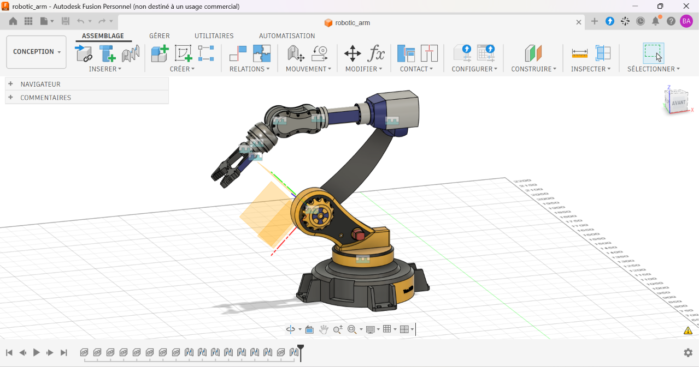

# Bras robotisé articulé

Bras robotisé articulé modélisé sous Autodesk Fusion : base, corps d'épaule, segments de bras, poignet et pince.

## Contexte

Projet de modélisation réalisé d'après un modèle de référence. Le modèle de départ ne m'appartient pas et n'est pas présenté comme ma conception originale.

## Caractéristiques

| Élément | Valeur |
|---|---|
| Nombre de pièces | 8 (base + 7 pièces) |
| Encombrement de l'assemblage | environ 663 × 390 × 601 mm |
| Base | environ 390 × 390 × 104 mm |
| Matériau prévu | Acier |

## Ma contribution

- modélisation de pièces
- assemblage
- liaisons
- rendus

## Fichiers

| Fichier | Contenu |
|---|---|
| `robotic_arm.f3z` | Archive Fusion de l'assemblage complet |
| `robotic_arm.step` | Assemblage complet, format universel |
| `robotic_arm.stl` | Maillage de l'assemblage, visualisable en 3D sur GitHub |
| `pieces/` | Les 8 pièces séparées (base, jaw1 à jaw7) aux formats .f3d, .step et .stl |
| `images/` | Rendus et captures |

## Outils

- Autodesk Fusion (licence personnelle, usage non commercial)

## Pistes d'amélioration

- Définir les mouvements et les limites des articulations, puis réaliser une analyse de mouvement.
- Motoriser le bras (servomoteurs) et le commander avec un microcontrôleur (Arduino / ESP32).

## Auteur

Yan AKOUEDENOUDJE — [Portfolio](https://yanakouedenoudje.github.io) · [GitHub](https://github.com/yanakouedenoudje)
