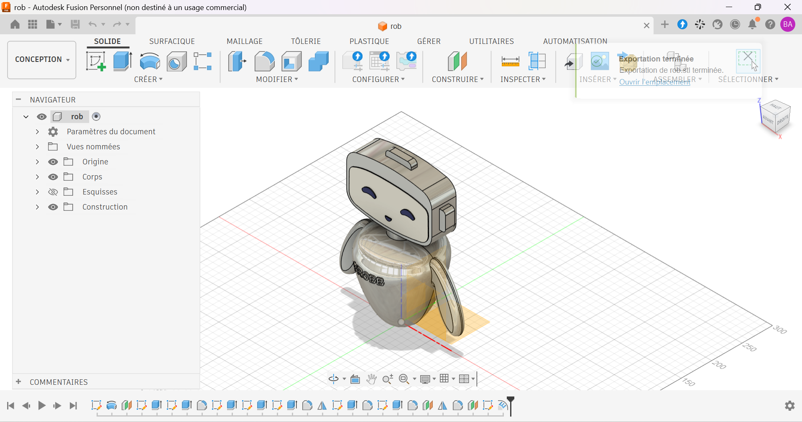

# YROBB : robot compagnon

Robot compagnon modélisé sous Autodesk Fusion : tête à visage en forme d'écran, corps arrondi, deux bras et nom gravé sur le corps.

## Contexte

Projet personnel de conception, réalisé entièrement par mes soins, sans modèle de référence.

## Caractéristiques

| Élément | Valeur |
|---|---|
| Structure | Un seul solide (modèle d'une seule pièce) |
| Dimensions | environ 198 × 118 × 239 mm |
| Matériau prévu | PLA (impression 3D) |

## Ma contribution

- Modélisation 3D complète du robot : esquisses, extrusions, congés et symétries.
- Gravure du nom sur le corps.

## Fichiers

| Fichier | Contenu |
|---|---|
| `yrobb.f3d` | Fichier Fusion (modèle paramétrique avec historique) |
| `yrobb.step` | Format universel |
| `yrobb.stl` | Maillage, visualisable en 3D sur GitHub |
| `images/` | Rendus et captures |

## Outils

- Autodesk Fusion (licence personnelle, usage non commercial)

## Pistes d'amélioration

- Décomposer le modèle en plusieurs pièces assemblées (tête, corps, bras).
- Prévoir des logements pour des servomoteurs dans les bras et pour l'électronique dans le corps.
- Réaliser un rendu et une impression 3D du robot.

## Auteur

Yan AKOUEDENOUDJE — [Portfolio](https://yanakouedenoudje.github.io) · [GitHub](https://github.com/yanakouedenoudje)
