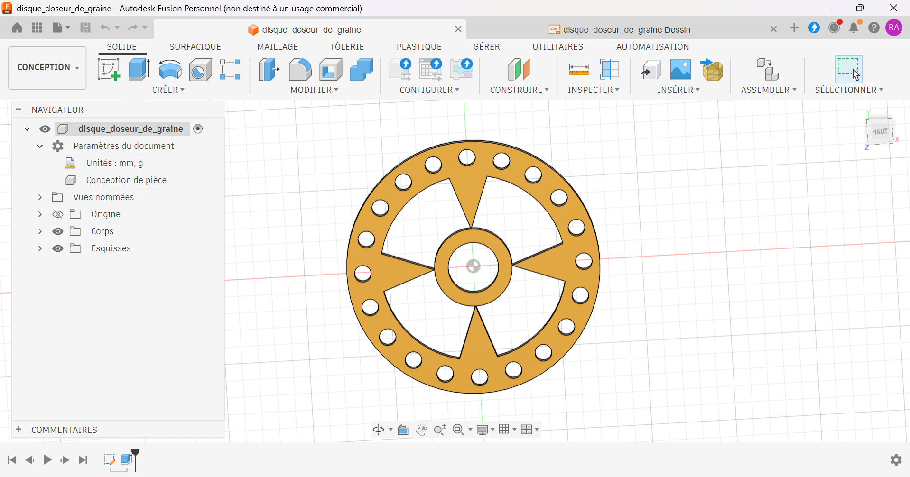

# Disque doseur de graines

Disque doseur de graines pour semoir, modélisé sous Autodesk Fusion.

## Contexte

[À COMPLÉTER : exercice d'apprentissage en autodidacte, ou pièce d'un projet de semoir. Précise la graine visée si tu en as une.]

## Caractéristiques

| Élément | Valeur |
|---|---|
| Diamètre extérieur | Ø75 mm |
| Épaisseur | 5 mm |
| Alésage central | Ø15 mm |
| Moyeu | R11,5 mm |
| Perçages | [À COMPLÉTER] × Ø5 mm sur Ø65,5 mm |
| Évidements | 4, rayon R27,5 mm |
| Matériau prévu | [À COMPLÉTER] |

## Fonctionnement

Chaque perçage de Ø5 mm reçoit une graine. Le disque, entraîné en rotation, amène les graines une à une vers la zone de dépôt.

## Fichiers

| Fichier | Contenu |
|---|---|
| `disque_doseur.step` | Format universel |
| `disque_doseur.stl` | Maillage, visualisable en 3D sur GitHub |
| `disque_doseur_plan.pdf` | Mise en plan |
| `images/` | Rendus et captures |

## Outils

- Autodesk Fusion (licence personnelle, usage non commercial)

## Pistes d'amélioration

- Ajouter le carter du semoir et l'arbre d'entraînement.
- Prévoir un entraînement par moteur pas à pas ou servomoteur piloté par microcontrôleur.
- Imprimer le disque et le tester avec de vraies graines.

## Auteur

Yan AKOUEDENOUDJE — [Portfolio](https://yanakouedenoudje.github.io) · [GitHub](https://github.com/yanakouedenoudje)
