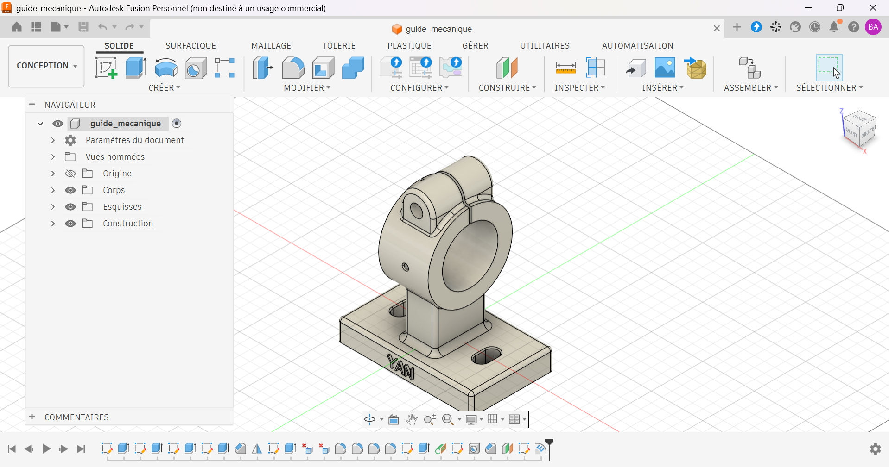

# Guide mécanique à collier fendu

Guide mécanique à collier fendu modélisé sous Autodesk Fusion.

## Contexte

Exercice d'apprentissage réalisé d'après un plan de référence. Le modèle 3D est de ma réalisation ; le plan de départ ne m'appartient pas et n'est pas reproduit dans ce dépôt.

## Caractéristiques

| Élément | Valeur |
|---|---|
| Embase | 130 × 80 mm, épaisseur 20 mm |
| Hauteur totale | 154 mm |
| Collier | Ø82 mm extérieur, alésage Ø54 mm |
| Fente de serrage | 2 mm |
| Perçage de l'oreille | Ø12 mm |
| Matériau prévu | Acier, Aluminium |

## Ma contribution

- Modélisation 3D complète de la pièce à partir du plan.
- Ajout d'une gravure personnalisée sur l'embase.

## Fichiers

| Fichier | Contenu |
|---|---|
| `guide_mecanique.step` | Format universel |
| `guide_mecanique.stl` | Maillage, visualisable en 3D sur GitHub |
| `images/` | Rendus et captures |

## Outils

- Autodesk Fusion (licence personnelle, usage non commercial)

## Pistes d'amélioration

- Concevoir la vis de serrage et la tige guidée pour compléter l'assemblage.
- Fabriquer la pièce par impression 3D et tester le serrage.

## Auteur

Yan AKOUEDENOUDJE — [Portfolio](https://yanakouedenoudje.github.io) · [GitHub](https://github.com/yanakouedenoudje)

