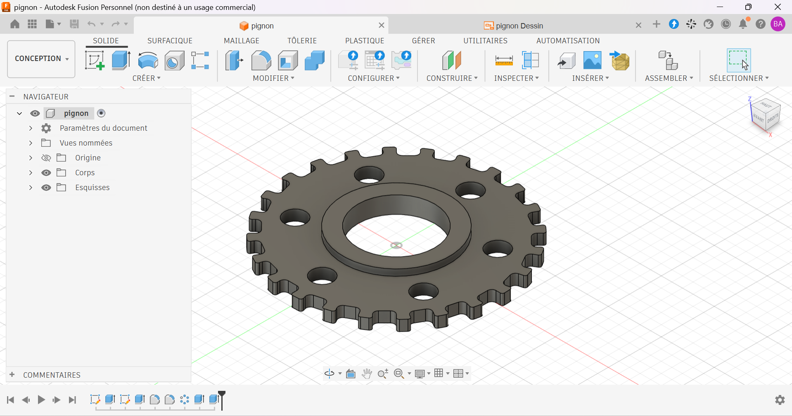

# Pignon

Pignon plat à 6 perçages et moyeu surélevé, conçu sous Autodesk Fusion. Le dossier contient le modèle 3D, la mise en plan cotée et les fichiers d'export pour la fabrication.

## Contexte

## Contexte

Exercice d'apprentissage en autodidacte sur Autodesk Fusion : modélisation 3D d'une roue à dentures rectangulaire arrondies et réalisation de sa mise en plan cotée.

## Caractéristiques

| Élément | Valeur |
|---|---|
| Diamètre extérieur | Ø70 mm |
| Épaisseur de la plaque | 5 mm |
| Hauteur du moyeu | 8 mm |
| Alésage central | Ø36 mm |
| Perçages | 6 × Ø10 mm, répartis régulièrement sur Ø70 mm |
| Nombre de dents | 24 |
| Matériau prévu | aluminium, acier... |

> Vérifie chaque valeur avec ta mise en plan avant de publier.

## Démarche de conception

1. Esquisse du profil extérieur avec les dents.
2. Extrusion de la plaque.
3. Création du moyeu surélevé et de l'alésage central.
4. Perçage des 6 trous par répétition circulaire.
5. Mise en plan avec vues, cotes et cartouche.

## Fichiers

| Fichier | Contenu |
|---|---|
| `pignon.f3d` | Fichier source Autodesk Fusion |
| `pignon.step` | Format universel, ouvrable dans tout logiciel de CAO |
| `pignon.stl` | Maillage pour l'impression 3D (visible directement sur GitHub) |
| `pignon_plan.pdf` | Mise en plan |
| `images/` | Rendus et captures |

## Outils

- Autodesk Fusion (licence personnelle, usage non commercial)

## Pistes d'amélioration

- Ajouter la pièce conjuguée (second pignon ou chaîne) pour valider le fonctionnement de l'ensemble.
- Compléter la mise en plan : vue en coupe, tolérances, état de surface, matériau et échelle.
- Fabriquer la pièce (impression 3D ou découpe laser) et la monter sur un moteur ou un servomoteur.

## Auteur

Yan AKOUEDENOUDJE — [Portfolio](https://yanakouedenoudje.github.io) · [GitHub](https://github.com/yanakouedenoudje)
