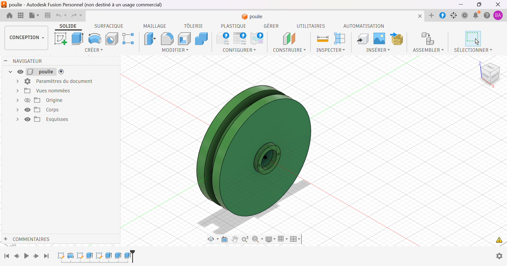

# Poulie de transmission à gorge

Poulie à gorge modélisée sous Autodesk Fusion.

## Contexte

Exercice d'apprentissage réalisé en autodidacte pour me former à la conception d'organes de transmission mécanique.

## Caractéristiques

| Élément | Valeur |
|---|---|
| Diamètre extérieur | Ø120 mm |
| Fond de gorge | Ø100 mm |
| Largeur de gorge | 10 mm |
| Épaisseur d'un flasque | 9.88 mm |
| Moyeu | Ø30 mm |
| Alésage | Ø20 mm |
| Petits perçages | Ø2 mm |
| Matériau prévu | Acier, Aluminium |

## Fichiers

| Fichier | Contenu |
|---|---|
| `poulie.step` | Format universel |
| `poulie.stl` | Maillage, visualisable en 3D sur GitHub |
| `poulie_plan.pdf` | Mise en plan |
| `images/` | Rendus et captures |

## Outils

- Autodesk Fusion (licence personnelle, usage non commercial)

## Pistes d'amélioration

- Adapter l'alésage à l'arbre et ajouter une rainure de clavette.
- Définir le profil de gorge selon la courroie utilisée.
- Réaliser un assemblage avec l'arbre et le pignon pour former une chaîne de transmission.

## Auteur

Yan AKOUEDENOUDJE — [Portfolio](https://yanakouedenoudje.github.io) · [GitHub](https://github.com/yanakouedenoudje)
