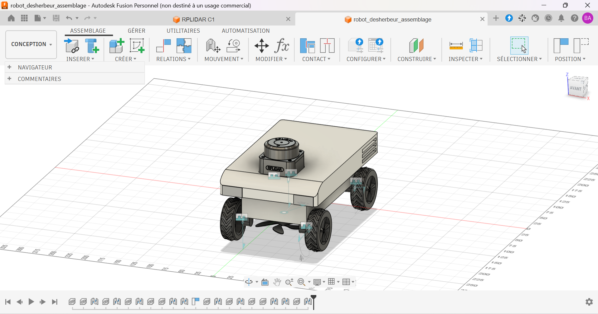

# Robot désherbeur

Petit robot désherbeur mobile à quatre roues modélisé sous Autodesk Fusion : châssis capoté, roues à crampons, moteurs de roues, outil de désherbage sous le châssis et capteur LiDAR RPLIDAR C1 sur le dessus.

## Contexte

Projet de conception d'un robot désherbeur pour l'agriculture. [À COMPLÉTER : confirmer que le châssis, les roues, les moteurs et l'outil sont de ma conception.]

Le capteur LiDAR RPLIDAR C1 est un composant commercial (Slamtec). [À COMPLÉTER : source du modèle 3D du RPLIDAR C1, réalisé par moi ou téléchargé, avec le lien.]

## Caractéristiques

| Élément | Valeur |
|---|---|
| Nombre de pièces distinctes | 5 (châssis, roue, moteur de roue, outil, capteur LiDAR) |
| Encombrement de l'assemblage | environ 150 × 251 × 150 mm |
| Châssis | 150 × 251 × 80 mm |
| Roue | Ø environ 64 mm, largeur 24 mm |
| Moteur de roue | environ 15 × 17 × 15 mm |
| Outil de désherbage | environ 80 × 79 × 18 mm |
| Capteur LiDAR RPLIDAR C1 | environ 56 × 41 × 65 mm |
| Matériau prévu | PLA (châssis, outil), TPU ou caoutchouc (pneus) : suggestion |

## Ma contribution

- Assemblage complet des pièces avec liaisons (joints) sous Fusion.
- [À COMPLÉTER : pièces modélisées par moi (châssis, roue, moteur, outil…).]

## Fichiers

| Fichier | Contenu |
|---|---|
| `robot_desherbeur_assemblage.f3z` | Archive Fusion de l'assemblage complet |
| `robot_desherbeur_assemblage.step` | Assemblage complet, format universel |
| `robot_desherbeur_assemblage.stl` | Maillage de l'assemblage, visualisable en 3D sur GitHub |
| `pieces/` | Les 5 pièces séparées (.f3d, .step, .stl) |
| `images/` | Rendus et captures |

## Outils

- Autodesk Fusion (licence personnelle, usage non commercial)

## Pistes d'amélioration

- Réaliser une mise en plan cotée de l'assemblage.
- Dimensionner la motorisation et l'outil de désherbage.
- Commander le robot (Arduino / ESP32) et exploiter le LiDAR pour la navigation.

## Auteur

Yan AKOUEDENOUDJE — [Portfolio](https://yanakouedenoudje.github.io) · [GitHub](https://github.com/yanakouedenoudje)
