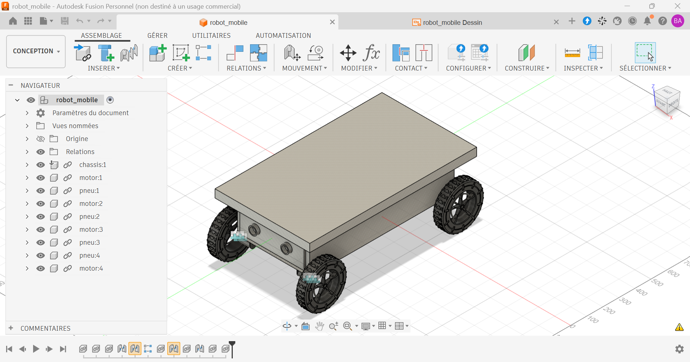

# Châssis de robot mobile à 4 roues motorisées

Châssis de robot mobile à quatre roues motorisées, modélisé sous Autodesk Fusion : plateforme supérieure, caisson porteur, quatre moteurs et quatre pneus à crampons.

## Contexte

Projet personnel de conception, réalisé entièrement par mes soins (châssis, moteurs, pneus, assemblage et mise en plan), sans modèle de référence.

## Caractéristiques

| Élément | Valeur |
|---|---|
| Nombre de pièces | 9 (1 châssis, 4 moteurs, 4 pneus) |
| Encombrement de l'assemblage | environ 1119 × 614 × 404 mm |
| Châssis | 1040 × 590 × 250 mm |
| Entraxe des roues (longueur) | 900 mm |
| Pneus | Ø environ 265 mm, largeur 80 mm |
| Moteurs | environ 40 × 97 × 42 mm (un par roue) |
| Matériau prévu | Aluminium (châssis), caoutchouc (pneus) |

## Ma contribution

- Modélisation 3D du châssis, des moteurs et des pneus.
- Assemblage complet des 9 pièces.
- Réalisation de la mise en plan : vues de face, de dessus et de côté, coupe A-A, vue 3D et cotation principale.

## Fichiers

| Fichier | Contenu |
|---|---|
| `robot_mobile.step` | Assemblage complet, format universel |
| `robot_mobile.stl` | Maillage de l'assemblage, visualisable en 3D sur GitHub |
| `robot_mobile_dessin.pdf` | Ma mise en plan (Fusion) |
| `pieces/` | Châssis, moteur et pneu séparés (.step et .stl) |
| `images/` | Rendus et captures |

## Outils

- Autodesk Fusion (licence personnelle, usage non commercial)

## Pistes d'amélioration

- Dimensionner la motorisation (masse, couple et vitesse nécessaires par roue).
- Intégrer batterie, microcontrôleur, drivers moteurs et capteurs dans le caisson.
- Ajouter une suspension pour les terrains irréguliers.
- Monter sur la plateforme une charge utile agricole (par exemple un semoir).

## Auteur

Yan AKOUEDENOUDJE — [Portfolio](https://yanakouedenoudje.github.io) · [GitHub](https://github.com/yanakouedenoudje)

