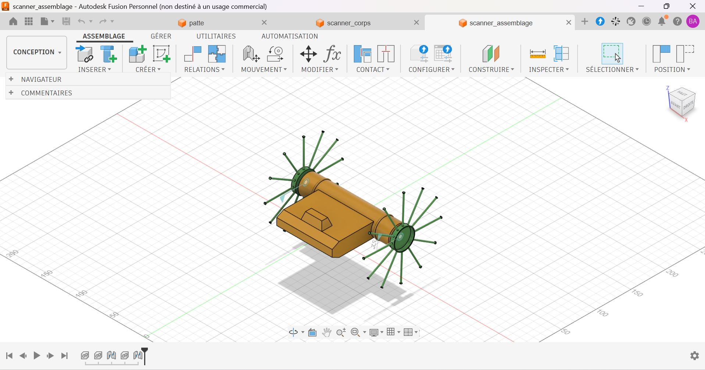

# Scanner pour champ

Scanner pour champ modélisé sous Autodesk Fusion : un corps porteur (platine et tube) et deux moyeux à rayons radiaux, appelés pattes, montés à ses extrémités.

## Contexte

Dispositif conçu pour scanner le champ et détecter l'état des plants.

## Caractéristiques

| Élément | Valeur |
|---|---|
| Nombre de pièces distinctes | 2 (corps, patte) |
| Encombrement de l'assemblage | environ 148 × 126 × 112 mm |
| Corps | environ 136 × 85 × 35 mm |
| Patte (moyeu à rayons) | environ 112 × 9 × 112 mm |
| Matériau prévu | PLA (impression 3D) : suggestion |

## Ma contribution

- Modélisation 3D du corps et de la patte.
- Assemblage des pièces sous Fusion.

## Fichiers

| Fichier | Contenu |
|---|---|
| `scanner_assemblage.f3z` | Archive Fusion de l'assemblage complet |
| `scanner_assemblage.step` | Assemblage complet, format universel |
| `scanner_assemblage.stl` | Maillage de l'assemblage, visualisable en 3D sur GitHub |
| `pieces/` | Corps et patte séparés (.f3d, .step, .stl) |
| `images/` | Rendus et captures |

## Outils

- Autodesk Fusion (licence personnelle, usage non commercial)

## Pistes d'amélioration

- Réaliser une mise en plan cotée.
- Préciser le fonctionnement (rotation des pattes, motorisation, capteurs).

## Auteur

Yan AKOUEDENOUDJE — [Portfolio](https://yanakouedenoudje.github.io) · [GitHub](https://github.com/yanakouedenoudje)
