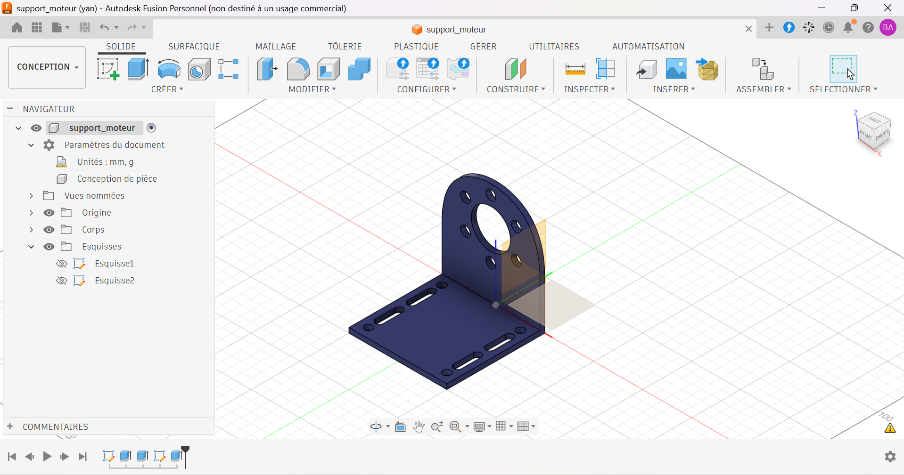

# Support moteur en équerre

Support moteur en équerre modélisé sous Autodesk Fusion.

## Contexte

Exercice d'apprentissage réalisé en autodidacte pour me former à la conception de pièces de fixation d'actionneurs.

## Caractéristiques

| Élément | Valeur |
|---|---|
| Platine | 100 × 100 mm |
| Épaisseur | 5 mm |
| Passage central (plaque verticale) | Ø40 mm |
| Perçages de fixation moteur | 6 × Ø10 mm sur Ø60 mm |
| Trous oblongs de la platine | 4, largeur 8 mm |
| Trous de fixation de la platine | 4 × Ø8 mm |
| Hauteur de l'axe moteur | 45 mm |
| Matériau prévu | Acier, Aluminium |

## Fichiers

| Fichier | Contenu |
|---|---|
| `support_moteur.step` | Format universel |
| `support_moteur.stl` | Maillage, visualisable en 3D sur GitHub |
| `support_moteur_plan.pdf` | Mise en plan |
| `images/` | Rendus et captures |

## Outils

- Autodesk Fusion (licence personnelle, usage non commercial)

## Pistes d'amélioration

- Modéliser le moteur correspondant et vérifier l'assemblage avec ce support.
- Ajouter des congés de raccordement ou une nervure pour rigidifier l'équerre.
- Fabriquer la pièce (impression 3D ou découpe et pliage) et la tester.

## Auteur

Yan AKOUEDENOUDJE — [Portfolio](https://yanakouedenoudje.github.io) · [GitHub](https://github.com/yanakouedenoudje)
