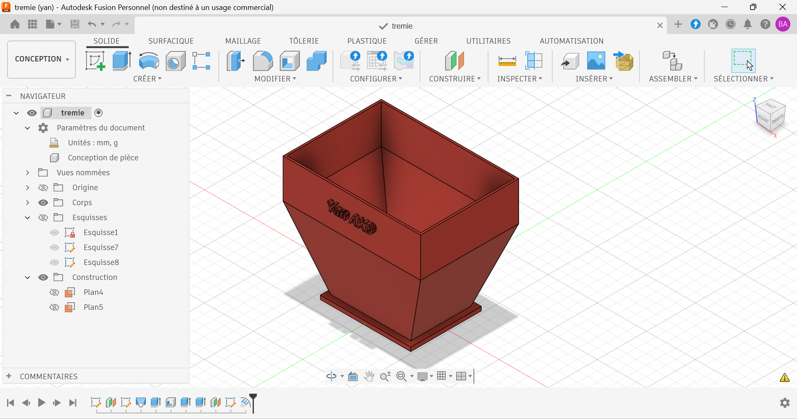

# Trémie de semoir

Trémie de semoir modélisée sous Autodesk Fusion.

## Contexte

Exercice d'apprentissage réalisé en autodidacte pour me former à la conception de pièces à parois minces (réservoir et entonnoir).

## Caractéristiques

| Élément | Valeur |
|---|---|
| Largeur en haut | 70 mm |
| Partie droite du réservoir | 19,82 mm |
| Paroi inclinée | 41,65 mm de longueur |
| Collerette de sortie | 46 × 29,36 mm, épaisseur 2 mm |
| Épaisseur des parois | 1 mm |
| Matériau prévu | Aluminium |

## Fonctionnement

Les graines sont versées dans le réservoir supérieur. La partie en entonnoir les guide par gravité vers la sortie, où la collerette permet de fixer la trémie au système de dosage.

## Fichiers

| Fichier | Contenu |
|---|---|
| `tremie.step` | Format universel |
| `tremie.stl` | Maillage, visualisable en 3D sur GitHub |
| `tremie_plan.pdf` | Mise en plan |
| `images/` | Rendus et captures |

## Outils

- Autodesk Fusion (licence personnelle, usage non commercial)

## Pistes d'amélioration

- Vérifier l'angle des parois pour assurer l'écoulement des graines visées.
- Ajouter des perçages de fixation sur la collerette et un couvercle.
- Assembler la trémie avec le disque doseur et son support.

## Auteur

Yan AKOUEDENOUDJE — [Portfolio](https://yanakouedenoudje.github.io) · [GitHub](https://github.com/yanakouedenoudje)
